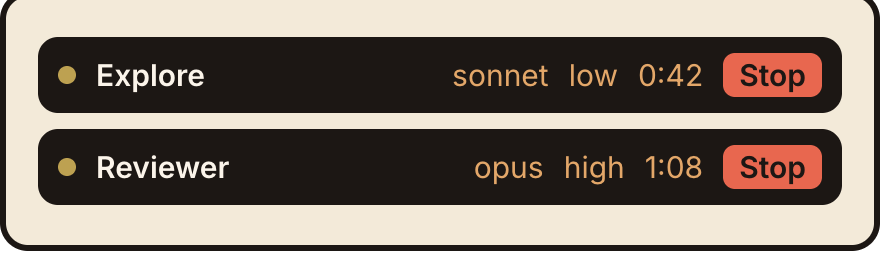

# subagent-lens

A Claude Code mod that adds a band above the prompt. Each running subagent gets one row showing its model, effort, type, task and elapsed time, with a Stop button.



*Illustration of the band (not a screenshot of the app).*

## Why

Subagents can run on a different model from the main session, and some models cost much more than others. This lets you see at a glance whether a subagent is running on the model you intended.

## How it works

- Each running subagent is tracked in `$.state`, so the list survives a hot reload.
- One 1-second heartbeat redraws the elapsed times.
- Every 5 seconds the list is reconciled with `$.agent.list()`, which drops rows whose agent has stopped, failed, or finished without the mod noticing.
- The band shows up to 6 rows and is empty when nothing is running.
- Stop ends that subagent and tells it to reply with what it has.

## Install

In Claude Code:

```
/plugin marketplace add cutemonstre/subagent-lens
```

Then install the `subagent-lens` plugin from that marketplace with `/plugin`.

## Layout

- `hooks/register.tsx`: the mod itself.
- `types/index.d.ts`: state types.
- `tests/subagent-lens.test.ts`: tests. They run inside Claude Code's mod runtime (`claude-code/testing`), not as a standalone test suite.

Built by directing AI coding agents (Claude Code), with design, review and testing by the author.

## License

MIT
